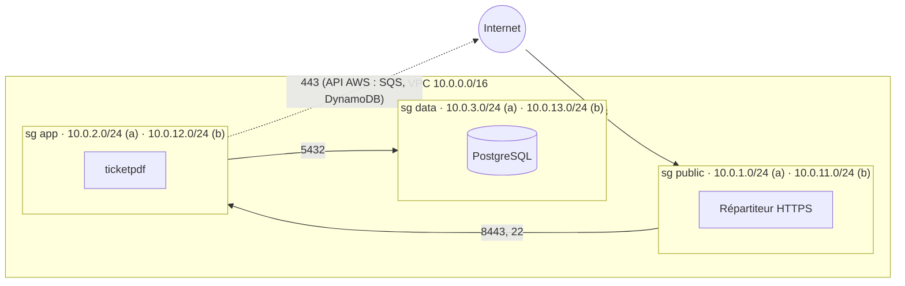

# REPORT-j1 : la base sécurisée de FlashTicket

VM : Multipass `flashticket`, Ubuntu 24.04.5 LTS (arm64, Mac Apple Silicon), 2 Go de RAM, IP `192.168.252.3`.
Accès : `ssh -i ~/.ssh/flashticket_td1_ed25519 deploy@192.168.252.3` (seul compte autorisé).

## Synthèse des mesures

| Indicateur | Avant | Après |
|---|---|---|
| Paquets installés (`dpkg -l \| grep -c ^ii`) | 663 | 637 |
| Lynis, indice de durcissement | **59** | **78** (+19) |
| `systemd-analyze security ticketpdf.service` | **9.2 UNSAFE** | **1.3 OK** |
| `scripts/verify-td1.sh` | | 27 OK, 0 KO |

## Partie A : VM minimale et accès SSH

**SSH** (`vm/10-hardening.conf`) : clé Ed25519 déposée pour `deploy` (sudo NOPASSWD via `/etc/sudoers.d/90-deploy`), connexion par clé testée **avant** de durcir. Ensuite `sshd -t`, `systemctl reload ssh` et une nouvelle connexion testée. Vérifié :

- mot de passe refusé : `Permission denied (publickey)` ;
- `root` et `ubuntu` refusés (`AllowUsers deploy`) ; conséquence : `multipass shell/exec` ne fonctionne plus, on passe par SSH `deploy` ;
- ajouts suggérés par Lynis : `AllowTcpForwarding no`, `AllowAgentForwarding no`, `MaxSessions 2`, `ClientAliveCountMax 2`, `TCPKeepAlive no`, `LogLevel VERBOSE`.

**Surface minimale** : services supprimés car inutiles sur un serveur sans matériel ni bureau : `modemmanager`, `multipath-tools`, `udisks2`, `packagekit`, `snapd`. Écoutes TCP restantes (`ss -tlnp`) :

| Adresse | Processus | Justification |
|---|---|---|
| `0.0.0.0:22`, `[::]:22` | sshd | administration (filtrée par nftables) |
| `*:8443` | ticketpdf | le service (filtré par nftables) |
| `127.0.0.53:53`, `127.0.0.54:53` | systemd-resolved | résolveur DNS local, joignable uniquement en loopback |

**Mises à jour automatiques** : `unattended-upgrades` installé et activé (`/etc/apt/apt.conf.d/20auto-upgrades`).

**Noyau** : `vm/99-flashticket.conf` copié dans `/etc/sysctl.d/` (le sujet indique `/etc/syxsctl.d/`, c'est une coquille), puis `sysctl --system` ; `net.ipv4.tcp_syncookies = 1`.

**Pare-feu** (`vm/nftables.conf`) : `PUBLIC_NET` remplacé par `192.168.252.1/32`, l'adresse de l'hôte vue avec `$SSH_CLIENT` / `who`. Chargement avec un retour arrière programmé (`systemd-run --on-active=90 nft flush ruleset`), annulé une fois la nouvelle connexion validée. Le service `nftables` est activé et les règles tiennent après redémarrage. La limite `10/minute` sur SSH a été observée en pratique : des connexions trop rapprochées expirent.

**Lynis, autres gains** (59 → 78) : mise à jour complète, `libpam-tmpdir`, `apt-show-versions`, `debsums`, liste noire des modules `dccp sctp rds tipc usb-storage` (`/etc/modprobe.d/flashticket-blacklist.conf`), core dumps désactivés (`/etc/security/limits.d/10-nocore.conf`), `login.defs` (UMASK 027, âge des mots de passe, tours SHA), bannières `/etc/issue*`.

> `auditd` a été essayé puis retiré : quand il tourne, les refus AppArmor partent dans `/var/log/audit/audit.log` et n'apparaissent plus dans `journalctl -k` / `dmesg`, là où le sujet et `verify-td1.sh` attendent la preuve. Lynis reste à 78 sans lui.

## Partie B : service systemd durci et AppArmor

Utilisateur système `ticketpdf` (sans shell, sans home), binaire `/opt/ticketpdf/bin/ticketpdf` (version arm64), données `/var/lib/ticketpdf` (0750, propriété de `ticketpdf`).

**Score d'exposition**, une famille de directives à la fois (`vm/ticketpdf.service`) :

| Étape | Directives ajoutées | Score |
|---|---|---|
| Unité de départ | | 9.2 UNSAFE |
| + Fichiers | `ProtectSystem=strict` + `ReadWritePaths=/var/lib/ticketpdf`, `ProtectHome`, `PrivateTmp`, `PrivateDevices`, `UMask=0027` | 7.9 EXPOSED |
| + Noyau | `ProtectKernelTunables/Modules/Logs`, `ProtectControlGroups`, `ProtectProc=invisible`, `ProcSubset=pid`, `ProtectHostname`, `ProtectClock` | 6.4 MEDIUM |
| + Privilèges | `NoNewPrivileges`, `CapabilityBoundingSet=` (vide : 8443 > 1024), `AmbientCapabilities=`, `RestrictSUIDSGID`, `LockPersonality`, `RestrictRealtime` | 4.2 OK |
| + Appels et réseau | `SystemCallFilter=@system-service ~@privileged @resources`, `SystemCallArchitectures=native`, `RestrictAddressFamilies=AF_INET AF_INET6`, `RestrictNamespaces`, `MemoryDenyWriteExecute` | **1.3 OK** |

`/healthz` répond `ok` à chaque étape : `ReadWritePaths` évite le piège de `ProtectSystem=strict`.

**Panne provoquée** : `sudo kill -9 <PID>` (PID 38282 remplacé par 38306, `NRestarts=1`) :

```
ticketpdf.service: Main process exited, code=killed, status=9/KILL
ticketpdf.service: Failed with result 'signal'.
ticketpdf.service: Scheduled restart job, restart counter is at 1.
Started ticketpdf.service - FlashTicket ticketpdf.
```

**AppArmor** (`vm/opt.ticketpdf.bin.ticketpdf.apparmor`, installé sous `/etc/apparmor.d/opt.ticketpdf.bin.ticketpdf`) : profil du cours, plus `network inet6 stream` (le service écoute sur `*:8443`). Chargé avec `apparmor_parser -r` puis `aa-complain`. L'application a été exercée (`/healthz`, `POST /tickets`, `GET /tickets/o-1.pdf`, lecture de `test.pdf`) : aucun événement `ALLOWED`, donc `aa-logprof` n'avait rien à proposer. Passage ensuite en `aa-enforce`, et `/sys/kernel/security/apparmor/profiles` affiche `/opt/ticketpdf/bin/ticketpdf (enforce)`.

**Test d'évasion** :

```
/debug/read?path=/etc/shadow               -> 403 lecture refusée : open /etc/shadow: permission denied
/debug/read?path=/etc/passwd               -> 403 lecture refusée : open /etc/passwd: permission denied
/debug/read?path=/var/lib/ticketpdf/test.pdf -> %PDF-1.4 ...  (réussit)
```

Preuve (`journalctl -k`) :

```
apparmor="DENIED" operation="open" profile="/opt/ticketpdf/bin/ticketpdf" name="/etc/passwd" comm="ticketpdf" requested_mask="r" denied_mask="r"
apparmor="DENIED" operation="open" profile="/opt/ticketpdf/bin/ticketpdf" name="/etc/shadow" comm="head" requested_mask="r" denied_mask="r"
```

Pour `/etc/shadow` (mode `640 root:shadow`), ce sont les droits Unix qui refusent d'abord l'utilisateur `ticketpdf`, avant qu'AppArmor ne soit consulté : aucune trace AppArmor n'est donc produite par la requête HTTP. Pour prouver que le profil bloque aussi ce fichier, il a été exécuté en **root** sous le profil : `sudo aa-exec -p /opt/ticketpdf/bin/ticketpdf -- head /etc/shadow` est refusé (seconde ligne). `/etc/passwd`, lisible par tous, montre le refus AppArmor directement sur le service.

## Partie C : réseau, chiffrement et accès

**TLS** : autorité locale `FlashTicket TD CA` (clé dans `/etc/ticketpdf/ca/`, 0600, hors du dossier lu par le service) et certificat `localhost` (SAN `DNS:localhost, IP:127.0.0.1`, P-256, 90 jours) dans `/etc/ticketpdf/tls/` (`tls.key` 0640 `root:ticketpdf`).

```
$ openssl s_client -connect localhost:8443 -CAfile /etc/ticketpdf/ca/ca.crt
New, TLSv1.3, Cipher is TLS_AES_128_GCM_SHA256
Verify return code: 0 (ok)
$ openssl s_client -tls1_1 -cipher 'DEFAULT:@SECLEVEL=0' -connect localhost:8443
tlsv1 alert protocol version (SSL alert number 70)
```

`ca.crt` est passé en 0644 : l'UMASK 027 l'avait créé illisible pour les clients, alors qu'un certificat est public.

**Réseau** (`network/network.tf`, AWS eu-west-3) : `terraform validate` renvoie *Success! The configuration is valid.* ; `terraform plan` donne *21 to add, 0 to change, 0 to destroy* (lancé hors ligne avec de faux identifiants via un fichier `*_override.tf` temporaire, non versionné).



- Les règles référencent des **groupes de sécurité**, pas des plages : seul un membre du groupe public peut joindre l'applicatif, seul un membre de l'applicatif peut joindre les données.
- Seul le segment public a une route vers la passerelle Internet ; aucune IP publique automatique.
- Groupe données : aucune règle de sortie.
- Écart assumé : la sortie applicative en 443 vers `0.0.0.0/0` sert à joindre les API AWS faute de NAT ou de VPC endpoints. Elle est commentée `shortcut:` dans le fichier, à restreindre aux préfixes des endpoints en production.

**IAM** (`iam/`, ARN avec le compte d'exemple `123456789012`) : **aucun `*`**.

| Politique | Actions | Ressource | Pourquoi |
|---|---|---|---|
| `create-order.json` | `sqs:SendMessage` | file `flashticket-orders` | publier une commande, rien d'autre (ni lecture, ni purge) |
| `process-order.json` | `sqs:ReceiveMessage`, `sqs:DeleteMessage`, `sqs:ChangeMessageVisibility`, `sqs:GetQueueAttributes` | file `flashticket-orders` | consommer : recevoir, acquitter, prolonger le traitement ; `GetQueueAttributes` est exigé par un déclencheur Lambda sur SQS |
| `process-order.json` | `dynamodb:PutItem` | table `flashticket-orders` | écrire la commande traitée, sans lecture ni suppression |

Si la file est chiffrée avec une clé KMS gérée par le client (et non SSE-SQS), ajouter `kms:GenerateDataKey` (producteur) et `kms:Decrypt` (consommateur) sur l'ARN de cette clé.

## Non fait

- Bonus LUKS sur fichier pour `/var/lib/ticketpdf`.
- `verify-td1.sh` lit le score systemd avec `$(NF-1)`, ce qui renvoie le mot `OK` au lieu du nombre sous Ubuntu 24.04 ; le vrai score est **1.3**.
