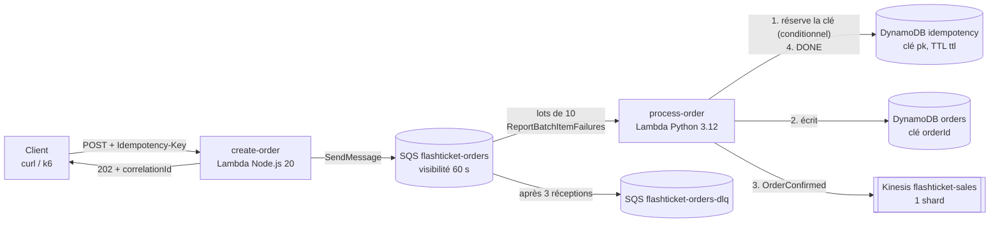

# REPORT-j2 — La prise de commande asynchrone

FlashTicket, jour 2. Tout tourne dans LocalStack 3.8.1 (Docker), région `eu-west-3`, sur un Mac (Apple Silicon, Docker Desktop 10 CPU / 8 Go).

## Résumé

| Point du barème | Résultat |
|---|---|
| API de commande (202 / 400) | 202 si la requête est valide, 400 sans clé ou si le corps est invalide (curl et smoke) |
| Aucune perte sous charge | 3 236 acceptées (202) = 3 236 traitées = 3 236 lignes dans orders, DLQ vide |
| Idempotence (5 envois, 1 commande) | 5 envois de la même clé : 1 ligne dans orders, 4 « doublon ignoré » |
| Reprise et DLQ (3 tentatives) | 3 réceptions espacées de 60 s, puis la DLQ après 184 s |
| Échecs partiels | lot de 10 : les 5 réussis traités une seule fois, seuls les 5 en échec rejoués |
| Journaux corrélés et analyse du plantage | correlationId suivi de create-order à orders ; analyse ci-dessous |

## Schéma du flux



## Partie A — Ressources et API

**Ressources** : `scripts/bootstrap.sh`, relançable (une ressource présente est conservée, les réglages de la file sont réappliqués).

| Ressource | Réglages |
|---|---|
| `flashticket-orders-dlq` | file des messages morts |
| `flashticket-orders` | VisibilityTimeout **60 s**, RedrivePolicy `maxReceiveCount` **3** vers la DLQ |
| `orders` | clé `orderId`, PAY_PER_REQUEST |
| `idempotency` | clé `pk`, PAY_PER_REQUEST, **TTL sur `ttl`** (ENABLED) |
| `flashticket-sales` | Kinesis, **1 shard** |

Vérification : `aws sqs get-queue-attributes --attribute-names VisibilityTimeout RedrivePolicy` renvoie `60` et `{"deadLetterTargetArn":"…flashticket-orders-dlq","maxReceiveCount":"3"}` ; `describe-time-to-live` renvoie `ENABLED` sur `ttl`.

**create-order** (`functions/create-order/src/index.ts`) :

- exige l'en-tête `Idempotency-Key`, sinon **400** ;
- décode le corps (base64 si `isBase64Encoded`) et valide `eventId` (texte non vide), `seats` (entier de 1 à 6) et `email`. Si le corps est invalide, il répond **400** avec la liste des erreurs ;
- publie `{orderId, correlationId, idempotencyKey, eventId, seats, email, createdAt}` dans la file (la clé et le correlationId aussi en attributs de message) ;
- journalise une ligne JSON `commande acceptée` et répond **202** `{orderId, correlationId}`, avec l'en-tête `x-correlation-id` ;
- le client SQS est créé hors du handler.

Tests : `npm test` (6 tests, l'envoi SQS est simulé), `npx tsc -p .` sans erreur.

```text
$ curl -i -X POST "$URL" -H 'content-type: application/json' -H 'Idempotency-Key: test-curl-1' \
    -d '{"eventId":"concert-2026","seats":2,"email":"issa@example.com"}'
HTTP/1.1 202 ACCEPTED
x-correlation-id: c1f5e58c-6c88-41e8-9ec1-a75d9f4ce89e
{"orderId":"62077c1e-…","correlationId":"c1f5e58c-…"}

sans Idempotency-Key           -> 400 {"errors":["en-tête Idempotency-Key obligatoire"]}
eventId vide, seats 9, email   -> 400 {"errors":["eventId : texte non vide attendu","seats : entier de 1 à 6 attendu","email : adresse invalide"]}

$ aws sqs receive-message --queue-url "$QUEUE_URL" --message-attribute-names All
Body : {"orderId":"62077c1e-…","correlationId":"c1f5e58c-…","idempotencyKey":"test-curl-1","eventId":"concert-2026","seats":2,…}
```

Si on envoie un corps sans `content-type: application/json`, curl le déclare en `x-www-form-urlencoded` et LocalStack le transmet encodé comme un formulaire. Il est alors refusé en 400 (JSON invalide), ce qui est le comportement voulu.

`make smoke` : **Tout est vert**. Il vérifie le 202 d'une requête valide, le 400 sans clé, une seule commande pour 5 envois, et le message empoisonné arrivé en DLQ après 185 s.

## Partie B — Consommateur idempotent

**process-order** (`functions/process-order/handler.py`). Pour chaque message du lot :

1. **Réserver la clé** : `put_item` dans `idempotency` avec `ConditionExpression="attribute_not_exists(pk)"`. L'item écrit est `{pk, status: IN_PROGRESS, orderId, startedAt, ttl: maintenant + 86400}`. Si la condition échoue (`ConditionalCheckFailedException`), on relit la clé :
   - `DONE` : c'est un doublon. On journalise `doublon ignoré` et le message compte comme réussi ;
   - `IN_PROGRESS` depuis moins de 30 s : un autre traitement est peut-être en cours. On lève une erreur, et le message sera retenté après la visibilité ;
   - `IN_PROGRESS` depuis plus de 30 s : c'est forcément un plantage, car le timeout de la fonction est de 10 s. On **reprend** avec l'`orderId` enregistré. Une écriture conditionnelle sur `startedAt` garantit qu'une seule copie fait la reprise.
2. **Écrire la commande** dans `orders`, avec la clé `orderId`.
3. **Publier `OrderConfirmed`** dans `flashticket-sales`, avec la clé de partition `orderId`.
4. **Marquer la clé `DONE`**, seulement à la fin.

Le handler renvoie `{"batchItemFailures": [...]}` : seuls les messages en échec sont rejoués. La liaison avec la file utilise des lots de 10 et `ReportBatchItemFailures` :

```text
$ aws lambda list-event-source-mappings --function-name process-order
{"batch": 10, "types": ["ReportBatchItemFailures"], "state": "Enabled"}
```

Pour les tests, une injection de pannes est désactivée par défaut. Elle s'active avec `FAULT_INJECTION=1` et le champ `_fault` du message, ce qui permet de provoquer les échecs sans modifier le code. Tests unitaires : `python3 -m unittest`, 7 tests (DynamoDB et Kinesis sont simulés).

Les trois tests du sujet ont été lancés avec `bash scripts/partie-b.sh tout` ; les résultats sont recopiés tels quels.

### Test 3 — Doublon : 5 envois, 1 commande

```text
envoi 1 à 5 : HTTP 202 (×5)
lignes dans orders pour la clé doublon-1795007374 : 1 (1 attendue)
idempotency : c74059a8-…  DONE  ttl=1795093774
journaux « doublon ignoré » pour cette clé : 4
```

Les 5 requêtes produisent 5 messages avec 5 `orderId` différents mais la même clé. Le premier réserve la clé, les 4 autres sont reconnus comme doublons : **une seule ligne** dans `orders`.

### Test 4 — Message empoisonné : 3 tentatives puis DLQ

```text
envoyé à 14:10:52 (JSON invalide « {pas du json »)
réception 1 : Expecting property name enclosed in double quotes
réception 2 : Expecting property name enclosed in double quotes
réception 3 : Expecting property name enclosed in double quotes
arrivé en DLQ après 184 s
```

**Le rôle de la visibilité.** À chaque réception, le message devient invisible pendant 60 s. Le traitement échoue en quelques millisecondes, mais comme le message n'est pas supprimé, il ne réapparaît qu'à la fin de ces 60 s. On a donc 3 réceptions espacées d'environ 60 s. À la tentative suivante, SQS voit que `ReceiveCount` dépasse `maxReceiveCount` (3) et range le message dans la DLQ. Total : environ 3 × 60 s, plus le délai de lecture de LocalStack, soit **184 s**.

La visibilité joue deux rôles. Elle empêche qu'une autre copie prenne un message en cours de traitement. Et elle donne le rythme des nouvelles tentatives : 60 s laisse le temps à une panne passagère de se résorber.

Elle doit rester bien plus longue que la durée maximale du traitement : 60 s contre un timeout de 10 s, soit 6 fois. Sinon, un message réapparaîtrait en plein traitement et serait traité deux fois.

### Test 5 — Échec partiel : 1 message sur 2 dans un lot de 10

```text
messages envoyés : 10 (send-message-batch), taille des lots reçus : [10]
premier passage : messages 0,2,4,6,8 traités 1 fois ; messages 1,3,5,7,9 en échec 1 fois
lignes dans orders : 5 (les pairs)
70 s plus tard  : messages 0,2,4,6,8 toujours traités 1 fois ; 1,3,5,7,9 en échec 2 fois
```

Le lot de 10 est arrivé en une seule invocation. Le handler n'a renvoyé que les 5 messages en échec : les 5 réussis ont été supprimés et **n'ont pas été retraités**, seuls les impairs ont été rejoués.

### Plantage après l'écriture, avant DONE (test réel)

`bash scripts/partie-b.sh crash` : la panne se produit une seule fois, puis l'injection est coupée.

```text
1er passage : panne simulée : crash_after_write
juste après : orders=1 ligne, clé=IN_PROGRESS
{"level":"error","msg":"message en échec","correlationId":"crash-1795007883-c","receiveCount":"1",…}
{"level":"warn","msg":"reprise après plantage","orderId":"crash-1795007883-o","abandonedSince":61}
{"level":"info","msg":"commande traitée","orderId":"crash-1795007883-o"}
après le renvoi : orders=1 ligne, clé=DONE
événements OrderConfirmed pour cette commande dans le stream : 1
```

## Partie C — Charge, cold start, observabilité

### 1–2. Charge k6 et compteurs

Script : `loadtest/k6.js`, celui du kit, sans modification. Une chauffe de 30 s monte de 1 à 20 requêtes par seconde, puis la mesure tient **20 requêtes par seconde pendant 150 s**, soit environ 3 000 commandes. Chaque requête a sa propre `Idempotency-Key`.

Le sujet parle de 50 requêtes par seconde pendant 60 s. Le kit est réglé à 20 par seconde pendant plus longtemps, pour le même volume, parce que LocalStack sature au-delà (voir le commentaire en tête de `k6.js`).

Commandes : `make load`, puis `bash scripts/partie-c.sh compteurs` une fois la file vidée.

**Passage mesuré, avec les copies de `create-order` déjà chaudes :**

| Compteur | Valeur |
|---|---|
| Requêtes acceptées (k6 `orders_accepted_202`) | **3 236** |
| Commandes acceptées (journaux `create-order`) | 3 236 |
| Messages traités (journaux `commande traitée`) | **3 236** |
| Lignes dans `orders` | **3 236** |
| DLQ | **0** (vide) |
| Messages en échec, doublons ignorés, reprises | 0, 0, 0 |
| File principale après la charge | 0 visible, 0 en cours |

Les trois nombres du sujet sont **égaux** et la DLQ est **vide**.

Côté k6, phase de mesure : `http_req_failed` 0 % (seuil < 1 % : OK), p95 227 ms (seuil < 2 000 ms : OK), médiane 10,5 ms. k6 a sauté 78 itérations, surtout pendant la chauffe. C'est pour ça qu'il y a 3 236 commandes et non les 3 315 prévues ; toutes celles envoyées ont été acceptées.

**Premier passage, avec un LocalStack tout juste démarré (copies froides) :**

| Compteur | Valeur |
|---|---|
| Requêtes envoyées / 202 reçus | 2 050 / 1 990 |
| Échecs côté client (k6 a abandonné après 60 s) | 60 |
| Itérations abandonnées par k6 (60 VU tous occupés) | 1 265 |
| p95 de la phase de mesure | 17,8 s |
| Messages publiés (lignes dans `orders`) | 2 034 |
| Messages traités | 2 034, DLQ vide, 0 échec |
| Doublons ignorés / reprises après plantage | 2 / 3 |

Que s'est-il passé ? Chaque requête simultanée sans copie libre fait démarrer un conteneur Lambda. LocalStack en a démarré 60, autant que de VU k6. Pendant ces démarrages, certaines invocations de `create-order` ont atteint leur timeout de 10 s, et 60 clients ont abandonné après 60 s. **Aucune commande acceptée n'est perdue** : les 2 003 commandes journalisées « acceptée » sont toutes dans `orders`, vérifié par orderId.

Par contre, 44 commandes sont dans `orders` alors que leur client n'a jamais reçu le 202. Le message était parti dans SQS avant que la réponse ne se perde. En vrai, ces clients réessaieraient **avec la même `Idempotency-Key`**, et le consommateur les dédoublonnerait. C'est exactement la raison d'être de la clé.

Côté consommateur, quelques invocations de `process-order` ont atteint leur timeout en plein lot, et le lot est revenu après 60 s. L'idempotence a tenu : 2 « doublon ignoré » pour les messages déjà DONE, 3 « reprise après plantage » pour les clés restées IN_PROGRESS. Il n'y a eu aucun doublon dans `orders`.

C'est le cold start de la partie suivante, vu à grande échelle. On l'atténue avec des copies pré-chauffées (ici : relancer la charge pendant que les copies sont chaudes ; en production : concurrence provisionnée).

`bash scripts/partie-c.sh vider` remet les compteurs à zéro sans toucher aux fonctions. Il purge les files, recrée les tables et efface les journaux.

**Mesure de LocalStack, à savoir.** `aws logs filter-log-events --filter-pattern '"commande traitée"'` compte trop sous LocalStack : il retient les lignes qui contiennent un seul des mots. Lors d'un premier essai, il a compté 1 321 « messages en échec » alors qu'il n'y en avait aucun. `scripts/partie-c.sh` relit donc tous les événements et compte localement sur le champ `msg` des lignes JSON.

### 3. Démarrage à froid

`bash scripts/partie-c.sh coldstart` : 660 s sans aucune requête, puis trois appels à la suite, chronométrés par curl (`time_total`).

```text
inactivité de 660 s avant le premier appel…
1er appel (froid) : 202 en 2.032609 s
2e appel (chaud)  : 202 en 0.023256 s
3e appel (chaud)  : 202 en 0.020572 s
durées du handler vues par Lambda (lignes REPORT) : 115 ms, puis 13,5 ms, puis 12,7 ms
```

| | Temps vu par le client | Durée du handler |
|---|---|---|
| 1er appel après 10 min d'inactivité | **2 033 ms** | 115 ms |
| Appels suivants | **21 à 23 ms** | 13 ms |

Le premier appel est environ **90 fois plus lent**. Avant l'attente, LocalStack faisait tourner 60 copies de `create-order` (celles de la charge). Après 11 minutes, il n'en restait aucune : il libère une copie inutilisée au bout de 10 min, comme le fournisseur réel.

Les quelque 1,9 s ajoutées viennent du démarrage d'un conteneur, du lancement de Node.js 20 et du code hors du handler (import du SDK, création du client SQS). Le handler lui-même est plus lent au premier appel (115 ms contre 13 ms), car la première requête SQS ouvre la connexion. Ensuite, le client créé hors du handler est réutilisé.

Pour l'atténuer en production :
- un paquet léger : esbuild ne met que le client SQS, et le paquet fait moins de 1 Mo ;
- plus de mémoire, donc plus de processeur pendant l'initialisation ;
- surtout, de la concurrence provisionnée sur `create-order` pendant les ouvertures de vente.

Des pings réguliers ne suffiraient pas : la charge à froid ci-dessus a demandé 60 copies d'un coup.

### 4. Suivre une commande de bout en bout

`bash scripts/partie-c.sh suivre <correlationId>` interroge les deux groupes de journaux, puis la table :

```text
réponse : {"orderId":"b2af33c6-a1cc-4e54-9620-be3b79646cf9","correlationId":"e3d691b0-5f83-4826-a23c-6e43d97eb813"}
== /aws/lambda/create-order
  14:34:39.900  {"level":"info","msg":"commande acceptée","fn":"create-order","correlationId":"e3d691b0-…","orderId":"b2af33c6-…"}
== /aws/lambda/process-order
  14:34:40.941  {"level": "info", "msg": "lot reçu", "size": 1, "correlationIds": ["e3d691b0-…"]}
  14:34:40.942  {"level": "info", "msg": "commande traitée", "correlationId": "e3d691b0-…", "orderId": "b2af33c6-…"}
== orders
  b2af33c6-a1cc-4e54-9620-be3b79646cf9	seats=3	CONFIRMED
```

Le correlationId est créé par `create-order`, ou repris de l'en-tête `x-correlation-id` s'il est fourni. Il est renvoyé au client dans le 202 et dans l'en-tête `x-correlation-id`, puis voyage dans le message SQS. Il est journalisé à chaque étape et stocké dans `orders` et dans l'événement `OrderConfirmed`.

Ici, la commande a mis environ 1 s entre l'acceptation et l'écriture : c'est le délai de lecture de la file par LocalStack. Le même identifiant relie aussi les incidents : la ligne `message en échec` et la ligne `reprise après plantage` du test de la partie B portent le correlationId de la commande concernée.

## Que se passe-t-il si process-order plante après avoir écrit la commande, mais avant de marquer la clé DONE ?

**Ce qui se passe** (vérifié par le test réel ci-dessus) :

1. La commande est dans `orders`, mais la clé reste `IN_PROGRESS` et `OrderConfirmed` n'est pas publié.
2. Le message n'a pas été supprimé de la file (le handler a échoué). Il réapparaît après les 60 s de visibilité et SQS le renvoie.
3. Au renvoi, la réservation conditionnelle échoue (la clé existe). Le consommateur relit la clé : `IN_PROGRESS` depuis 61 s, bien plus que le timeout de la fonction (10 s). Aucun traitement vivant ne peut encore la tenir, donc c'est un plantage : il **reprend**.
4. Il réécrit la commande avec le **même `orderId`** (celui stocké dans la clé). C'est la même ligne qui est écrite une seconde fois, il n'y a pas de doublon. Il publie ensuite `OrderConfirmed`, puis marque la clé `DONE`.

Résultat : 1 ligne dans `orders`, 1 événement dans le stream, clé `DONE`. **Rien n'est perdu ni doublé.**

**Ce qui se passerait avec un code naïf :**

- **DONE marqué trop tôt** (avant d'écrire) : au renvoi, la clé dirait « déjà fait » et le message serait ignoré. La commande serait **perdue**, alors que le client a reçu 202.
- **Un IN_PROGRESS traité comme un doublon** : même effet, la commande ne serait jamais confirmée.
- **Un IN_PROGRESS toujours retenté sans reprise** : 3 échecs, puis la DLQ. La commande serait écrite mais jamais confirmée.

**La limite qui reste :** un plantage *après* la publication dans le stream et *avant* `DONE` fait publier `OrderConfirmed` deux fois. Il n'y a pas de transaction commune entre DynamoDB et Kinesis. Les consommateurs du stream doivent donc eux aussi être idempotents, en dédoublonnant sur `orderId`. La solution propre est le pattern outbox, ou DynamoDB Streams sur la table `orders` comme source unique des événements.

Enfin, le TTL de 24 h sur `idempotency` borne la taille de la table. Un renvoi plus tardif que 24 h serait traité comme une nouvelle commande, ce qui n'arrive pas avec SQS : la rétention par défaut est de 4 jours, mais il y a 3 tentatives espacées de 60 s puis la DLQ.

## Ce qu'il faudrait en production

Le flux tourne ici **en local uniquement**, avec des réglages volontairement ouverts. En production, il faudrait :

- **Autorisation sur l'API** : la Function URL est en `--auth-type NONE`, donc n'importe qui peut commander. Il faudrait un API Gateway devant, avec un authorizer JWT (Cognito ou l'IdP de FlashTicket), ou au minimum `AWS_IAM` et des requêtes signées.
- **Limitation de débit** : un plan d'usage et un throttling API Gateway par client et global, plus AWS WAF (rate-based rules) contre les robots à l'ouverture des ventes. Il faudrait aussi une **concurrence réservée** sur `create-order` et une **concurrence maximale** sur l'event source mapping de `process-order` (backpressure), pour protéger DynamoDB.
- **Rôles IAM de moindre privilège** à la place du faux `lambda-role` :
  - `create-order` : `sqs:SendMessage` sur la file, rien d'autre (repris du TD1) ;
  - `process-order` : `sqs:ReceiveMessage/DeleteMessage/ChangeMessageVisibility/GetQueueAttributes`, `dynamodb:PutItem/GetItem/UpdateItem` sur les deux tables, `kinesis:PutRecord` sur le stream.
- **Alarmes** : DLQ non vide (`ApproximateNumberOfMessagesVisible > 0`), âge du plus vieux message de la file, taux d'erreur et throttles des fonctions. Il faudrait aussi une procédure de **redrive** de la DLQ une fois la cause corrigée.
- **Chiffrement** SSE-KMS sur SQS, DynamoDB et Kinesis, et rétention des journaux CloudWatch.
- **Données personnelles** : l'e-mail n'est écrit dans aucun journal, mais il est stocké dans la file et la table. Il faut une durée de conservation et un accès restreint.
- **Infrastructure en code** : les ressources sont créées à la main ce jour 2. Elles seront reprises en Terraform au jour 3.
